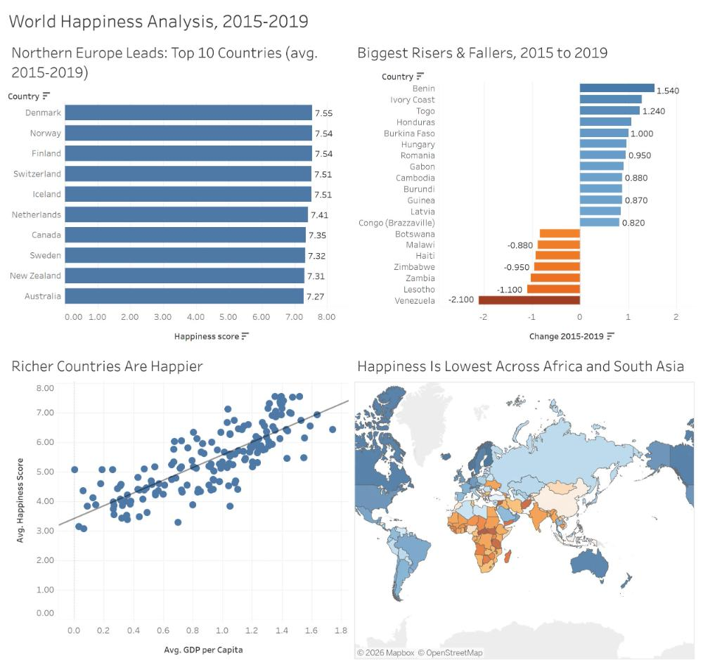

# World Happiness Analysis, 2015–2019 (Tableau)

An interactive Tableau dashboard exploring how happiness differs across countries, how it changed between 2015 and 2019, and how closely it tracks national wealth.

**🔗 Live dashboard:** [World Happiness Analysis on Tableau Public](https://public.tableau.com/app/profile/oladotun.ajayi/viz/worldhappinessanalysis_17776699803910/Dashboard1)



## Key findings

- **Northern Europe leads.** Denmark (7.55), Norway, Finland, Switzerland and Iceland are the five happiest countries on average across 2015–2019.
- **Richer countries are happier.** Happiness rises steadily with GDP per capita, though many countries sit well above or below the trend.
- **The biggest gains came from West Africa.** Benin (+1.54), Ivory Coast (+1.28) and Togo (+1.24) improved the most between 2015 and 2019.
- **Venezuela's decline stands alone.** It fell 2.10 points, roughly twice the drop of any other country.
- **Happiness is lowest across Sub-Saharan Africa and South Asia**, as the map makes clear.

## Dashboard contents

| View | What it shows |
|---|---|
| Top 10 countries | Highest average happiness score, 2015–2019, sorted |
| Biggest risers & fallers | Countries whose score changed by at least 0.8 points between 2015 and 2019 |
| Richer countries are happier | Scatter of average happiness vs. GDP per capita, with trend line |
| Map | Average happiness by country (orange = lower, blue = higher) |

## Techniques used

- **Level-of-detail calculation** for each country's change over time:
  ```
  {FIXED [Country]: AVG(IF [Year]=2019 THEN [Happiness Score] END)}
  - {FIXED [Country]: AVG(IF [Year]=2015 THEN [Happiness Score] END)}
  ```
- **Top N filter** ranked by average happiness score
- **Condition filter** (`ABS(MIN([Change 2015-2019])) >= 0.8`) to keep only the largest movers
- Diverging orange–blue palette (colorblind-friendly) used consistently across the change chart and map
- Fixed 1000 × 950 layout so labels don't overlap

## Data

World Happiness Report 2015–2019 (Gallup World Poll), via the Kaggle *World Happiness Report* dataset. The happiness score is each country's average answer to the Cantril ladder question, from 0 (worst possible life) to 10 (best possible life). GDP per capita is the report's estimated contribution of economic output to the score, not a dollar figure.

## Files

- `world happiness analysis.twbx` — packaged Tableau workbook (open with Tableau Desktop or Tableau Public)

## Author

Oladotun Ajayi — [Tableau Public profile](https://public.tableau.com/app/profile/oladotun.ajayi)
